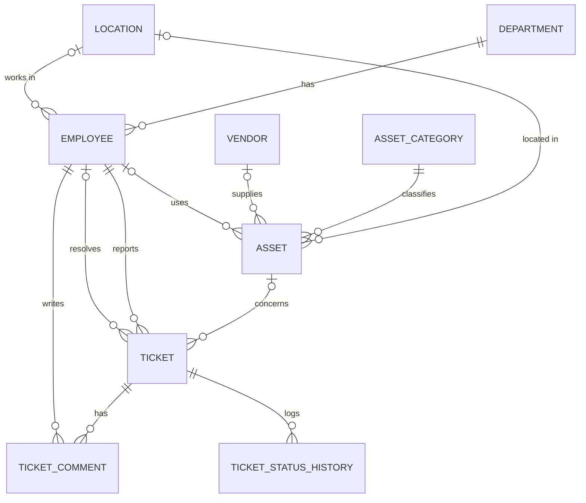

# IT Inventory & Helpdesk Database

A PostgreSQL database for managing an organisation's IT equipment and support tickets —
designed from a conceptual ER model through to SQL reports that answer real business questions.

🇭🇷 *Baza podataka za evidenciju IT opreme i prijava kvarova (helpdesk) u PostgreSQL-u — od ER modela do poslovnih izvještaja u SQL-u.*

**Scenario:** *Kvarner Trade d.o.o.* is a fictional company with 22 employees, 42 IT assets and
150 support tickets over the last 12 months. Its IT manager needs answers: are we meeting our
response targets, which devices should be replaced, and how much budget will that take?

---

## Key findings

**1. Monday mornings are the bottleneck.** Almost half of all tickets (74 of 150) arrive on Mondays,
most of them before 10:00.

| Weekday | 07–10 | 10–13 | 13–16 | Total |
|---|---:|---:|---:|---:|
| Mon | 35 | 24 | 15 | **74** |
| Tue | 7 | 5 | 6 | 18 |
| Wed | 9 | 4 | 6 | 19 |
| Thu | 6 | 7 | 2 | 15 |
| Fri | 9 | 8 | 7 | 24 |

➡️ *Recommendation: schedule the full IT team on Monday mornings.*

**2. Critical incidents miss the SLA half of the time**, while all other priorities stay within target.

| Priority | SLA target | Avg. hours | Median hours | Within SLA |
|---|---:|---:|---:|---:|
| critical | 4 h | 3.8 | 4.0 | **50 %** |
| high | 24 h | 11.9 | 11.0 | 100 % |
| medium | 72 h | 37.7 | 39.7 | 100 % |
| low | 168 h | 98.5 | 100.7 | 100 % |

➡️ *Recommendation: an escalation procedure for critical tickets (server and network outages).*

**3. One printer generates more tickets than any other device.** The HP LaserJet in office 101
(out of warranty) has 13 tickets, mostly repeated paper jams within days of each other.

➡️ *Recommendation: replace it. Total replacement budget for equipment out of warranty or
expiring within 6 months: approx. **€18,500**, mostly laptops and desktops.*

---

## Data model



The conceptual ER diagram in Chen notation and the full relational model are in [`docs/`](docs/).

### Design decisions

- **Business rules live in the database**, not only in the application — `CHECK` constraints ensure
  that a resolved ticket always has a resolution time, an open one never does, and a device can be
  assigned to a person only while it is in use.
- **Status changes are audited automatically** — a trigger writes every change to
  `ticket_status_history`; another keeps `resolved_at` in sync when a ticket is resolved or reopened.
- **Foreign keys are indexed** — PostgreSQL does not do this automatically.
- **Reproducible test data** — the seed script uses a fixed random seed, so every run produces
  the same dataset and the same report results.

---

## What's inside

| File | Contents |
|---|---|
| [`sql/01_schema.sql`](sql/01_schema.sql) | 9 tables, constraints, indexes |
| [`sql/02_seed.sql`](sql/02_seed.sql) | Realistic test data generated in SQL (`generate_series`, weighted random choice) |
| [`sql/03_logic.sql`](sql/03_logic.sql) | 2 triggers, 3 views, `resolve_ticket` stored procedure with validation |
| [`sql/04_queries.sql`](sql/04_queries.sql) | 11 business questions answered with SQL |

### Business questions in `04_queries.sql`

1. Monthly ticket volume and change vs. previous month
2. SLA compliance per priority (average, median, % within target)
3. Workload distribution and ranking of IT staff
4. Most common problems
5. Devices with the most tickets — replacement candidates
6. Recurring faults on the same device within 30 days
7. Tickets per employee by department
8. Busiest weekdays and times of day
9. Warranty planning and replacement budget
10. Inventory value by purchase year with a running total
11. Data quality checks

**SQL techniques used:** CTEs, window functions (`LAG`, `RANK`, running `SUM`), aggregate `FILTER`,
`percentile_cont`, `LATERAL` joins, PL/pgSQL triggers and procedures, row locking (`FOR UPDATE`).

Example — finding devices that break again soon after being fixed:

```sql
WITH asset_tickets AS (
    SELECT asset_id, title, created_at,
           LAG(resolved_at) OVER (PARTITION BY asset_id ORDER BY created_at) AS prev_resolved_at
    FROM ticket
    WHERE asset_id IS NOT NULL
)
SELECT *
FROM asset_tickets
WHERE created_at - prev_resolved_at BETWEEN INTERVAL '0' AND INTERVAL '30 days';
```

---

## How to run

Requires PostgreSQL 15 or newer. Run the scripts in order:

```bash
psql -U postgres -f sql/01_schema.sql
psql -U postgres -f sql/02_seed.sql
psql -U postgres -f sql/03_logic.sql
psql -U postgres -f sql/04_queries.sql
```

Everything is created in a separate `helpdesk` schema, and `01_schema.sql` rebuilds it from scratch,
so the scripts can be re-run at any time.

Try the stored procedure:

```sql
CALL helpdesk.resolve_ticket(146, 19, 'Password reset, user can log in.');
SELECT * FROM helpdesk.ticket_status_history WHERE ticket_id = 146;
```

> **Windows:** run `chcp 65001` in the terminal first so Croatian characters display correctly.

---

*All company and person names in this project are fictional.*
