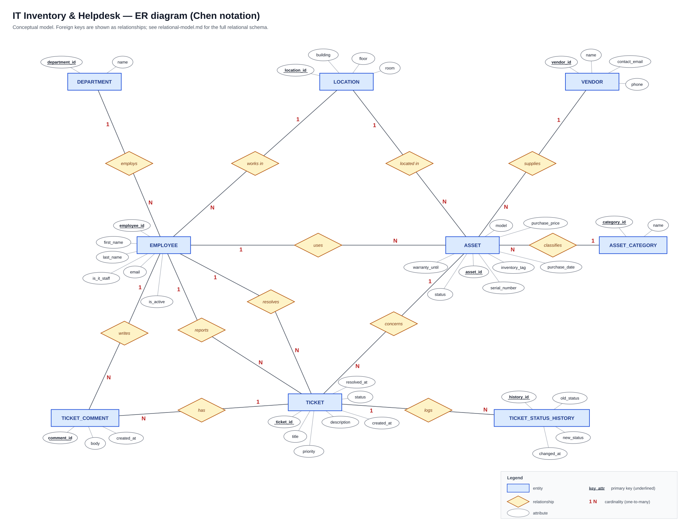

# Relational model

Logical model derived from the [ER diagram](er-diagram.svg). Every 1:N relationship from the
conceptual model becomes a foreign key on the "N" side.

## Notation

Primary keys are <ins>underlined</ins>, foreign keys are marked with `#`.

- **DEPARTMENT** (<ins>department_id</ins>, name)
- **LOCATION** (<ins>location_id</ins>, building, floor, room)
- **EMPLOYEE** (<ins>employee_id</ins>, first_name, last_name, email, #department_id, #location_id, is_it_staff, is_active)
- **VENDOR** (<ins>vendor_id</ins>, name, contact_email, phone)
- **ASSET_CATEGORY** (<ins>category_id</ins>, name)
- **ASSET** (<ins>asset_id</ins>, inventory_tag, #category_id, #vendor_id, model, serial_number, purchase_date, purchase_price, warranty_until, status, #location_id, #assigned_to)
- **TICKET** (<ins>ticket_id</ins>, #asset_id, #reported_by, #assigned_to, title, description, priority, status, created_at, resolved_at)
- **TICKET_COMMENT** (<ins>comment_id</ins>, #ticket_id, #author_id, body, created_at)
- **TICKET_STATUS_HISTORY** (<ins>history_id</ins>, #ticket_id, old_status, new_status, changed_at)

## Relationships → foreign keys

| Relationship (ER) | Cardinality | Foreign key | References | Optional? | On delete |
|---|---|---|---|---|---|
| employs | DEPARTMENT 1 : N EMPLOYEE | `employee.department_id` | `department` | no | restrict |
| works in | LOCATION 1 : N EMPLOYEE | `employee.location_id` | `location` | yes | restrict |
| classifies | ASSET_CATEGORY 1 : N ASSET | `asset.category_id` | `asset_category` | no | restrict |
| supplies | VENDOR 1 : N ASSET | `asset.vendor_id` | `vendor` | yes | restrict |
| located in | LOCATION 1 : N ASSET | `asset.location_id` | `location` | yes | restrict |
| uses | EMPLOYEE 1 : N ASSET | `asset.assigned_to` | `employee` | yes | restrict |
| concerns | ASSET 1 : N TICKET | `ticket.asset_id` | `asset` | yes | restrict |
| reports | EMPLOYEE 1 : N TICKET | `ticket.reported_by` | `employee` | no | restrict |
| resolves | EMPLOYEE 1 : N TICKET | `ticket.assigned_to` | `employee` | yes | restrict |
| has | TICKET 1 : N TICKET_COMMENT | `ticket_comment.ticket_id` | `ticket` | no | **cascade** |
| writes | EMPLOYEE 1 : N TICKET_COMMENT | `ticket_comment.author_id` | `employee` | no | restrict |
| logs | TICKET 1 : N TICKET_STATUS_HISTORY | `ticket_status_history.ticket_id` | `ticket` | no | **cascade** |

Comments and status history have no meaning without their ticket, so they are deleted together
with it (`ON DELETE CASCADE`). All other references block deletion while dependent rows exist.

## Tables

Legend: **PK** primary key · **FK** foreign key · **UQ** unique

### DEPARTMENT

| Attribute | Type | Key | NULL | Constraint / note |
|---|---|---|---|---|
| department_id | INT (identity) | PK | NOT NULL | |
| name | VARCHAR(100) | UQ | NOT NULL | |

### LOCATION

| Attribute | Type | Key | NULL | Constraint / note |
|---|---|---|---|---|
| location_id | INT (identity) | PK | NOT NULL | |
| building | VARCHAR(100) | UQ (building, room) | NOT NULL | |
| floor | SMALLINT | | NULL | |
| room | VARCHAR(20) | UQ (building, room) | NOT NULL | |

### EMPLOYEE

| Attribute | Type | Key | NULL | Constraint / note |
|---|---|---|---|---|
| employee_id | INT (identity) | PK | NOT NULL | |
| first_name | VARCHAR(50) | | NOT NULL | |
| last_name | VARCHAR(50) | | NOT NULL | |
| email | VARCHAR(255) | UQ | NOT NULL | |
| department_id | INT | FK → department | NOT NULL | |
| location_id | INT | FK → location | NULL | |
| is_it_staff | BOOLEAN | | NOT NULL | default `FALSE` |
| is_active | BOOLEAN | | NOT NULL | default `TRUE`; former employees are kept for history |

### VENDOR

| Attribute | Type | Key | NULL | Constraint / note |
|---|---|---|---|---|
| vendor_id | INT (identity) | PK | NOT NULL | |
| name | VARCHAR(100) | UQ | NOT NULL | |
| contact_email | VARCHAR(255) | | NULL | |
| phone | VARCHAR(30) | | NULL | |

### ASSET_CATEGORY

| Attribute | Type | Key | NULL | Constraint / note |
|---|---|---|---|---|
| category_id | INT (identity) | PK | NOT NULL | |
| name | VARCHAR(50) | UQ | NOT NULL | Laptop, Desktop, Monitor, Printer, Network, Server, Phone |

### ASSET

| Attribute | Type | Key | NULL | Constraint / note |
|---|---|---|---|---|
| asset_id | INT (identity) | PK | NOT NULL | |
| inventory_tag | VARCHAR(20) | UQ | NOT NULL | e.g. `INV-2024-0001` |
| category_id | INT | FK → asset_category | NOT NULL | |
| vendor_id | INT | FK → vendor | NULL | |
| model | VARCHAR(100) | | NOT NULL | |
| serial_number | VARCHAR(50) | UQ | NULL | |
| purchase_date | DATE | | NOT NULL | |
| purchase_price | NUMERIC(10,2) | | NULL | `>= 0` |
| warranty_until | DATE | | NULL | `>= purchase_date` |
| status | VARCHAR(20) | | NOT NULL | `in_stock`, `in_use`, `in_repair`, `retired`; default `in_stock` |
| location_id | INT | FK → location | NULL | |
| assigned_to | INT | FK → employee | NULL | allowed only when `status = 'in_use'` |

### TICKET

| Attribute | Type | Key | NULL | Constraint / note |
|---|---|---|---|---|
| ticket_id | INT (identity) | PK | NOT NULL | |
| asset_id | INT | FK → asset | NULL | NULL = not tied to a device (e.g. password reset) |
| reported_by | INT | FK → employee | NOT NULL | |
| assigned_to | INT | FK → employee | NULL | IT staff member handling the ticket |
| title | VARCHAR(150) | | NOT NULL | |
| description | TEXT | | NULL | |
| priority | VARCHAR(10) | | NOT NULL | `low`, `medium`, `high`, `critical`; default `medium` |
| status | VARCHAR(15) | | NOT NULL | `open`, `in_progress`, `resolved`, `closed`; default `open` |
| created_at | TIMESTAMPTZ | | NOT NULL | default `now()` |
| resolved_at | TIMESTAMPTZ | | NULL | `>= created_at`; set **if and only if** status is `resolved` or `closed` |

### TICKET_COMMENT

| Attribute | Type | Key | NULL | Constraint / note |
|---|---|---|---|---|
| comment_id | INT (identity) | PK | NOT NULL | |
| ticket_id | INT | FK → ticket | NOT NULL | on delete cascade |
| author_id | INT | FK → employee | NOT NULL | |
| body | TEXT | | NOT NULL | |
| created_at | TIMESTAMPTZ | | NOT NULL | default `now()` |

### TICKET_STATUS_HISTORY

| Attribute | Type | Key | NULL | Constraint / note |
|---|---|---|---|---|
| history_id | INT (identity) | PK | NOT NULL | |
| ticket_id | INT | FK → ticket | NOT NULL | on delete cascade |
| old_status | VARCHAR(15) | | NULL | NULL for the first entry (ticket created) |
| new_status | VARCHAR(15) | | NOT NULL | |
| changed_at | TIMESTAMPTZ | | NOT NULL | default `now()` |

Rows are written automatically by the `ticket_log_status` trigger (see `sql/03_logic.sql`).

## Normalisation

The schema is in **third normal form (3NF)**:

- **1NF** — all attributes are atomic (e.g. location is split into building, floor and room).
- **2NF** — every table has a single-column surrogate primary key, so there are no partial dependencies.
- **3NF** — no transitive dependencies: department, location, vendor and category names are stored
  once in their own tables and referenced by key, never repeated in `employee` or `asset`.
